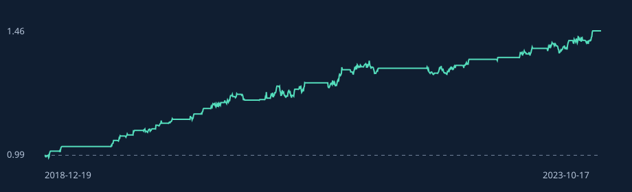

# SpreadLab

**An auditable, cost-aware walk-forward pairs research experiment in Python.**

Research question: can a residual-reversion signal survive delayed execution,
trading costs and a less mean-reverting regime?

This small project emphasizes falsifiable assumptions and correct accounting.
It is a research scaffold, not a production trading system. The committed demo
uses **synthetic prices with mean reversion deliberately built in**. Its returns
are not evidence of a real-world trading edge or investment performance.



## Run in one minute

Python 3.10+; no runtime dependencies, API keys or network access required.
From the repository root:

```bash
python -m unittest discover -s tests -v
python -m spreadlab
```

Open `reports/demo/index.html` for the standalone tear sheet. Inspect
`summary.json` for settings, input fingerprint and formation/trading boundaries;
`daily.csv` contains every signal, end-of-day position, return and cost.

To use your own aligned adjusted daily closes:

```bash
python -m spreadlab --csv data/my_pair.csv --out reports/my_pair --cost-bps 5
```

Schema: `date,a,b`, with ISO dates in strictly increasing order and positive
finite prices. Duplicate dates are rejected; missing observations are **not**
filled or interpolated. Align both series before import. Supply at least 254
observations. Price adjustment quality and provenance remain the caller's
responsibility. The demo generator counts weekdays, not exchange holidays.

## Design

| Component | Protocol |
|---|---|
| Formation | Rolling 252 observations; OLS log(A) on intercept and log(B) |
| Trading | Next 63 observations; hedge and residual scale remain frozen |
| Signal | Training-normalized residual; entry at absolute z >= 1.5 |
| Exit | Absolute z <= 0.25, mean crossing, absolute z >= 4, or 20 trading intervals |
| Timing | Signal at close t-1, execution at close t, P&L begins after close t |
| Position | Long/short log-spread hedge; daily gross exposure at most 1 |
| Frictions | 5 bps per one-way turnover; 100 bps/year on short exposure |
| Fold boundary | Liquidate and pay costs, then begin next fold flat |
| Invalid model | Stay flat if regression degenerates or beta is outside [0.1, 3] |
| Uncertainty | Circular 20-day block bootstrap, 1,000 replicates, fixed seed |

Parameters are explicit illustrative choices, not an optimized result. The
20-day holding limit includes the interval ending at the exit execution close.
The stop is a delayed signal exit, **not a guaranteed loss limit**.

The hedge is dollar exposure proportional to `(1, -beta)`, normalized by
`1 + beta`; this approximates log-spread changes. It is not generally dollar
neutral, market-beta neutral, or an exact replication of the log residual.

## Accounting that can be inspected

At each close the engine first marks yesterday's holdings to market and deducts
borrow, then computes turnover against the drifted holdings, then pays fees.
Post-cost holdings are rescaled to the remaining capital. A conservative fee
reserve keeps gross exposure below one after fees. This includes small daily
rebalancing trades, not just entries and exits. Short proceeds and cash earn
zero; equity compounds net returns. Borrow uses the prior close short exposure
and a 252-observation convention rather than calendar-day financing.

Tests verify future-data invariance, delayed position accounting, gross
exposure, liquidations, deterministic results, input validation, and degenerate
price behavior. GitHub Actions runs tests on Python 3.10, 3.12 and 3.13.

## Reproduced demonstration

With default seed 7, the synthetic fixture has 1,512 observations and 1,260
out-of-sample observations. At 5 bps one-way costs, net cumulative return is
45.73%, annualized volatility 4.86%, zero-risk-free Sharpe 1.57 and maximum
drawdown -3.76%. **These are synthetic outputs, not market results.** The report
also reruns identical rules at 0, 2, 5, 10 and 20 bps. Borrow remains enabled
even in the zero-transaction-cost scenario.

Annualized returns use 252 observations/year. Sharpe is the sample mean divided
by sample standard deviation times sqrt(252), without a serial-correlation
adjustment. The bootstrap interval targets annualized arithmetic mean, not
CAGR or Sharpe, and conditions on the observed strategy path. It omits
refitting/selection uncertainty; structural breaks can invalidate its coverage.

## What would invalidate the thesis?

1. The spread does not remain stationary outside the formation period.
2. Profit disappears at plausible spread, borrow and impact assumptions.
3. Results depend on one pair, one threshold, one seed or one regime.
4. Data revisions, corporate actions, survivorship or pair selection explain the result.

OLS residual normalization alone does **not** establish cointegration. A next
research stage would use a predeclared universe, training-only cointegration
screen with multiple-testing control, an untouched final holdout and a realistic
execution/borrow model. See the [official statsmodels cointegration documentation](https://www.statsmodels.org/stable/generated/statsmodels.tsa.stattools.coint.html)
for the augmented Engle-Granger test. This implementation does not run that test.

## Repository map

```text
spreadlab/core.py       Data validation, generator, OLS, backtest and statistics
spreadlab/cli.py        Reproducible experiment and HTML/SVG report
tests/test_core.py      Accounting and temporal invariants
reports/demo/          Committed synthetic results, ready to inspect
docs/RESEARCH.md        Research choices, failure modes and next experiments
docs/INTERVIEW_ZH.md    Chinese walkthrough and interview preparation
.github/workflows/     Automated checks
```

No claim of affiliation with, endorsement by, or suitability for any specific
employer is implied. The best presentation is an honest explanation of the
assumptions, what has been verified, and what still requires empirical evidence.
